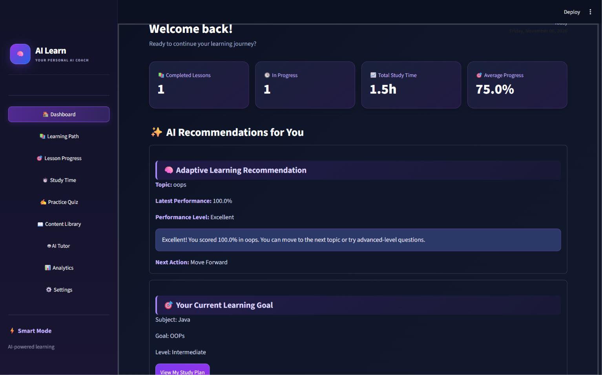
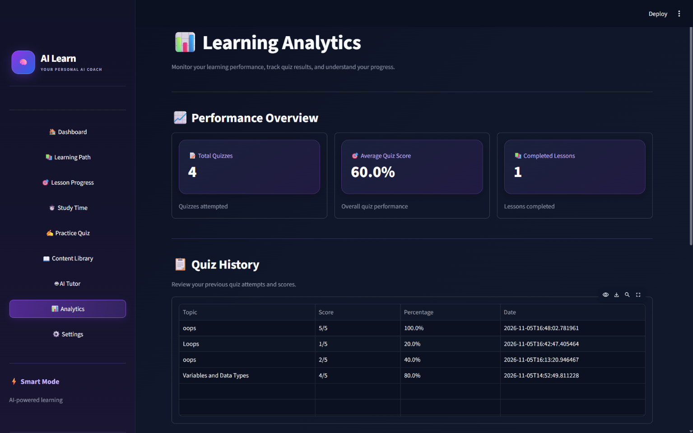

# 🧠 AI Learn – AI Personalized Learning Coach

<p align="center">
  <b>An AI-powered personalized learning platform that helps students learn smarter, track progress, and improve continuously.</b>
</p>

---

## 📌 Project Overview

**AI Learn** is an AI-powered personalized learning platform designed to make learning more effective, interactive, and accessible for students.

The application uses **Google Gemini AI** to generate customized study plans, create topic-based quizzes, evaluate student performance, identify weak areas, and provide personalized learning recommendations.

It adapts the learning experience according to the student's subject, knowledge level, learning goals, and available study time.

## 🎯 Project Objectives

- Provide personalized learning experiences based on individual student needs.
- Generate AI-powered day-wise study plans.
- Create topic-based multiple-choice practice quizzes.
- Automatically evaluate quiz answers and provide feedback.
- Identify weak topics and recommend revision activities.
- Track learning progress and study time.
- Provide an AI Tutor for doubt clarification.
- Help students improve their learning performance through analytics.

## ✨ Key Features

### 1. Dashboard
- Displays an overview of learning activities.
- Shows learning progress and performance.
- Provides quick access to application features.

### 2. Learning Path
- Generates personalized day-wise study plans.
- Considers the student's knowledge level and learning goals.
- Provides structured learning activities.

### 3. Lesson Progress
- Tracks lesson completion status.
- Helps students monitor their learning progress.
- Displays completed and pending lessons.

### 4. Study Time
- Tracks study sessions and learning duration.
- Records study activities.
- Helps students maintain consistent learning habits.

### 5. Practice Quiz
- Generates AI-powered multiple-choice questions.
- Supports Beginner, Intermediate, and Advanced levels.
- Evaluates submitted answers automatically.
- Displays scores and performance feedback.
- Identifies weak topics and suggests revisions.

### 6. Content Library
- Provides useful educational resources.
- Includes learning materials and external documentation.
- Helps students explore additional learning resources.

### 7. AI Tutor
- Provides AI-powered educational assistance.
- Explains concepts using simple language.
- Supports examples and follow-up questions.
- Helps students clarify their doubts.

### 8. Analytics
- Displays quiz history and performance statistics.
- Shows average quiz scores.
- Visualizes quiz performance through charts.
- Provides learning insights.

### 9. Settings
- Allows students to manage their learning profiles.
- Supports updating learning goals and preferences.
- Stores learner information.

## 🛠️ Technologies Used

| Technology | Purpose |
|---|---|
| Python | Core programming language |
| Streamlit | Web application development |
| Google Gemini AI | AI-powered learning assistance |
| SQLite | Database management |
| Pandas | Data handling and analysis |
| Python-dotenv | Environment variable management |

## 🏗️ System Architecture

The application follows a modular architecture in which the user interface, AI services, database operations, and learning management functions are maintained separately.

**Application Workflow:**

1. Student interacts with the Streamlit interface.
2. Learner information is managed through the application.
3. AI services communicate with Google Gemini.
4. Gemini generates personalized learning content.
5. Quiz and learning modules process student activities.
6. SQLite stores relevant learner data and progress.
7. Analytics displays learning performance and insights.

## 📂 Project Structure

```text
ai-personalized-learning-coach/
│
├── .streamlit/
│   └── config.toml
│
├── app.py
├── ai_service.py
├── database.py
├── learning_plan.py
├── quiz_manager.py
├── check_models.py
│
├── test_ai_service.py
├── test_gemini.py
├── test_quiz.py
│
├── requirements.txt
├── .gitignore
├── README.md
│
└── learning_coach.db
```

**Note:** The `.env` file and `.venv` folder are kept locally and should not be uploaded to GitHub. The database file should only be included if you intentionally want to share sample project data.

## ⚙️ Installation and Setup

Follow these steps to run the project locally.

### Step 1: Clone the Repository

```bash
git clone YOUR_GITHUB_REPOSITORY_URL
```

### Step 2: Navigate to the Project Directory

```bash
cd ai-personalized-learning-coach
```

### Step 3: Create a Virtual Environment

```bash
python -m venv .venv
```

### Step 4: Activate the Virtual Environment

For Windows:

```bash
.venv\Scripts\activate
```

### Step 5: Install Dependencies

```bash
pip install -r requirements.txt
```

### Step 6: Configure Gemini API Key

Create a `.env` file in the project directory.

Add the following configuration:

```env
GEMINI_API_KEY=your_gemini_api_key
```

Replace `your_gemini_api_key` with your actual Google Gemini API key.

**Important:** Never share or upload your actual API key to GitHub.

### Step 7: Run the Application

```bash
streamlit run app.py
```

The application will open in your browser.

## 🗄️ Database Management

AI Learn uses **SQLite** for storing application data.

The database supports:

- Learner profile information.
- Quiz history and scores.
- Learning progress.
- Study-related records.

The database allows learner information and progress records to persist between application sessions.

## 🤖 AI Integration

Google Gemini AI is integrated into the application to provide intelligent learning assistance.

AI capabilities include:

- Personalized study plan generation.
- AI-powered quiz generation.
- Educational explanations.
- AI Tutor responses.
- Learning support based on student knowledge levels.

The application uses the Gemini API through the Python Google GenAI client.

## 🧪 Testing and Validation

The project includes testing files for checking important application components:

- `test_ai_service.py`
- `test_gemini.py`
- `test_quiz.py`

The application has also been manually tested for major workflows, including profile management, quiz generation, answer evaluation, analytics, study tracking, and AI Tutor responses.

## 🔐 Security Considerations

- Gemini API credentials are configured through environment variables.
- The `.env` file should be excluded from version control.
- The `.venv` directory should not be uploaded to GitHub.
- Database operations are handled using SQLite.

## 🚀 Future Enhancements

- Advanced personalized learning recommendations.
- More detailed performance analytics.
- Additional interactive learning resources.
- Enhanced adaptive quiz difficulty.
- Improved progress visualization.
- Additional AI-powered learning capabilities.

## 📸 Application Screenshots
### 1. Dashboard


### 2. Learning Path


### 3. Practice Quiz


### 4. AI Tutor


### 5. Analytics


### 6. Content Library


Example Markdown syntax:

```markdown

```

## 👩‍💻 Author

**Vani Gorinta**

GitHub: [Vani-Gorinta](https://github.com/Vani-Gorinta)

## 📌 Project Status

**Status:** Developed – Final verification and documentation.

## 📄 License

This project is developed for educational and academic purposes.